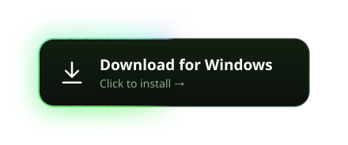
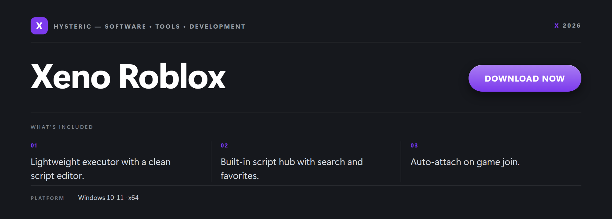

# Xeno Roblox 2026 Desktop — Lightweight Script Runner for Windows 11

   

---

Xeno Roblox 2026 is a Windows 11 desktop setup built around three things that matter in practice: a lightweight script runner, a searchable built-in script library, and auto-attach that fires the moment you join a game. No bloated menus, no hunting through folders mid-session — the runner stays out of the way until you need it. The library ships with search so you can pull the script you want in seconds instead of scrolling. It's a focused, no-nonsense build for players who want their tooling to keep up without slowing the game down.

## Features

**⚡ Lightweight Script Runner**

A lean execution core built for speed. Scripts fire in milliseconds without dragging the host down — no bloated runtimes, no background overhead. Load it, run it, move on.

**📚 Built-In Script Library with Search**

The full library ships in the box. Instant fuzzy search across every script by name, tag, or keyword gets you from launch to execution in seconds — no scrolling through folders, no external catalogs to sync.

**🎯 Auto-Attach on Game Join**

Flip it on once and forget it. The runner detects the game join event and attaches automatically, so your setup is live the moment you land in a server. Zero manual re-attach, zero missed sessions.

**🪶 Featherweight Footprint**

Runs quiet in the background with a minimal memory draw. The runner stays out of the way until you need it, keeping frame pacing intact during long sessions.

**🔍 Search-First Interface**

The library is the UI. Type, filter, select, execute — a workflow tuned for players who know what they want and don't want to click through menus to get it.

**🖥️ Windows 11 Native**

Built and tuned for the Windows 11 desktop stack. Clean startup, per-user setup, and no system-level clutter — the runner lives where it belongs and nowhere else.

## How it works

Xeno runs as a lightweight desktop layer that sits between you and the game client. It launches from a single self-contained folder tree on Windows 11 — no system-wide services, no kernel drivers, no scheduled tasks. The app registers per-user only, so it coexists cleanly with everything else on your machine.

The core loop is simple: you open the app, it finds the Roblox process, and it attaches. No manual process hunting, no alt-tabbing through a PID list. Auto-attach fires the moment you join a game, so the runner is live before the loading screen finishes. Detach is just as clean — one action and the hooks release.

The script runner itself is built for speed. Drop code in, hit execute, get output. It handles the attach handshake and the execution bridge for you, so you're writing scripts, not fighting plumbing. Cold starts are quick because the runtime is already on local disk — nothing gets fetched mid-session.

The built-in library ships with search baked in. Type a keyword, filter the list, load the script into the runner in one click. The library indexes locally, so results are instant and nothing leaves your machine. Your own saved scripts live alongside the bundled ones in the same searchable pool.

Everything under the hood is plain and inspectable: config in JSON and INI, logs in plain text, a binary shim for the attach layer. No telemetry, no phone-home, no network requirement after the initial download. Updates are drop-in — run a newer build over the existing folder and your config and saved scripts stay put.

## Supported Games

Xeno hooks cleanly into the Roblox experiences people actually play, and the auto-attach layer is built to keep up. On join, the runner negotiates the client and drops into the session without a manual attach dance — no hunting for a process, no re-running the loader after a respawn.

**Broad Roblox coverage.** The runner targets the standard Roblox client and handles the common experience families: sandbox and tycoon maps, obby and parkour courses, simulator and idle grinders, PvP and arena shooters, horror and story games, and the long tail of community-built places. If it launches in the Roblox player on Windows 11, the runner is designed to attach to it.

**Library that stays useful.** The built-in script library ships organized and searchable, so you can pull something relevant to the current game instead of scrolling a wall of pasted snippets. Search filters across the collection by name and purpose.

**Auto-attach on game join.** The attach layer re-arms after teleports, rejoin, and server hops, which matters for games that shuffle you between places mid-session. You keep your place in the library while the runner reconnects.

**Coverage limits, stated plainly.** Games with aggressive client-side anti-cheat or heavy server authority may refuse external attach, and the runner will surface that instead of hanging. Some experiences block scripting surfaces entirely — expect a clean failure there, not a workaround. Unusual client builds or modified players can also break attach until the runner is updated.

**Tested baseline.** Windows 11 x64 is the primary target, and the runner is validated against current Roblox player builds at release time. Older player versions may work but are not guaranteed. If a specific game misbehaves, the FAQ covers what to include in a report.

## 📸 Screenshot

## Configuration

Configuration lives in one place: the `config` folder next to the Xeno executable. Everything is plain-text JSON and INI, so you can tweak it in any editor without touching the binary. First launch seeds sane defaults under your user profile, and the launcher prints the exact paths it resolved — check that summary before you start flipping switches.

The three files that matter:

- **`settings.ini`** — window mode, UI scale, and the auto-attach toggle. Auto-attach fires the moment you join a game, so keep it on unless you're running a per-game script manually.
- **`runner.json`** — script runner behavior: execution delay after join, sandbox level, and the search index depth for the built-in library. Drop the delay to zero for instant execution, raise it if a heavier game loads slow and you want the script to wait.
- **`library.json`** — points the built-in script library at your local script folders and controls how search ranks results. Add paths here, not in the UI, if you want them to persist across updates.

Changes apply on next launch — no restart loop needed mid-session. If a config file goes bad, delete it and the launcher rewrites the defaults; your library paths regenerate from whatever folders are still present. Keep backups of `library.json` before editing by hand, since a broken JSON array means an empty library until you fix it.

One hard rule: don't point `library.json` at network shares. The search index builds at launch and a slow share stalls startup. Local disk only.

## FAQ

### 🪟 Which Windows versions does the build support?

The desktop setup targets Windows 11 on x64. It runs on current Windows 11 feature updates; older Windows releases and 32-bit targets are not supported.

### 📡 Does it need an internet connection?

No. The setup is designed for the Xeno Roblox 2026 workflow on the local machine, and the built-in script library is already bundled with the build. Once the build is in place, the script runner and library search work locally.

### 🔄 How does the script library stay current?

The library ships with the build and is searchable from the interface. When a newer build is deployed over the existing one, the bundled library is refreshed along with it. Your own saved scripts and configuration are kept.

### ⚙️ How does auto-attach on game join work?

The desktop setup watches for a game join and attaches automatically when the target process comes up, so you don't need to switch windows mid-session. If you prefer to control timing, auto-attach can be turned off in the configuration and attachment can be triggered manually.

### 🗂️ Where are my scripts and settings stored?

Settings and user scripts live in the per-user profile, not in Windows system directories. This keeps the install reversible and makes it easy to back up your configuration or move it between machines.

### 🛠️ What happens if a script fails to run?

A failed script logs its error in the console view with the failing line. The runner keeps the session alive, so you can fix the issue and re-run without rejoining the game.

### 🚀 Is the script runner heavy on hardware?

No. The runner is a lightweight foreground process with a small background helper for the auto-attach path. It does not add driver-level components and won't compete with the game for resources.

### 🗑️ How do I remove the setup cleanly?

Uninstall through the per-user installed apps list, or delete the folder if you deployed in portable mode. Removing the build does not touch your saved scripts or configuration unless you delete that folder yourself.

### 🐛 Something broke — how do I report it?

Open an issue on this repository with your Windows 11 build number, the build version, and the steps to reproduce. Include the console output from the session where the problem occurred.

## Disclaimer

**Independent build, independent rules.** This desktop setup is assembled and published by this project alone. It is not an official release from any studio, platform, or vendor, and no third party has signed off on it. Any product name that appears in these docs is used strictly to describe what the tool interacts with.

**Trademarks belong to their owners.** All game titles, platform names, logos, and brands referenced anywhere in this repository remain the property of their respective holders. Mentioning them here is identification, not endorsement, partnership, or sponsorship — and nothing in this repo should be read as a claim otherwise.

**You own your account and your choices.** Running scripts in online games can violate a platform's terms of service and can get an account limited or banned. That risk sits with you. Use this build only where you have permission to do so, and keep your own use within the rules of whatever platform you're on and the laws where you live.

**As-is, no promises.** This setup ships with no warranty, express or implied. The maintainers do not guarantee it will work on every machine, stay compatible with every game update, or produce any particular result. Bugs, breakage, and downtime happen; liability for any of it is disclaimed.

**Rights holders, speak up.** If you believe something in this repository steps on your rights, open an issue on the repo and it will be reviewed in good faith and handled promptly.

**Scope.** This disclaimer covers everything in the repository — documentation, release files, and any distribution pages tied to this project.

